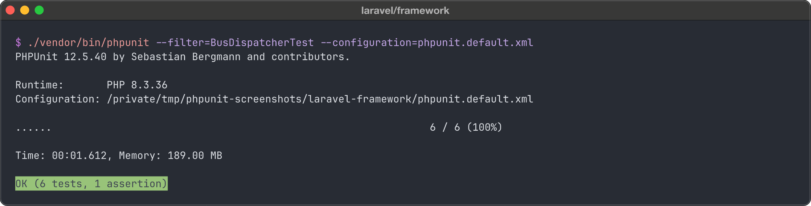
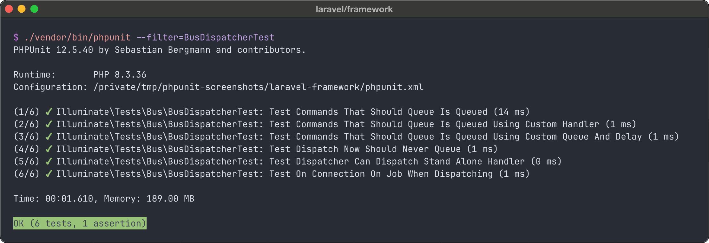

# 📋 Detailed PHPUnit Printer

It turns the default PHPUnit output...



... into a more informative output with readable function names and execution time allowing you to start fixing errors even before the whole suite finishes:



[](https://github.com/LimeDeck/phpunit-detailed-printer/actions/workflows/ci.yml)
[](https://github.com/limedeck/phpunit-detailed-printer)

## Installation

```
composer require limedeck/phpunit-detailed-printer --dev
```

### PHPUnit version compatibility

 PHPUnit     | Package
:------------|:----------
 10.x – 13.x | 7.x.x
 9.x.x       | 6.x.x
 8.x.x       | 5.x.x
 7.x.x       | 4.x.x
 6.x.x       | 3.2.x
 5.x.x       | 2.0.x


## Usage

Register the extension in `phpunit.xml`

```xml
<?xml version="1.0" encoding="UTF-8"?>
<phpunit ...>
    <extensions>
        <bootstrap class="LimeDeck\Testing\Extension"/>
    </extensions>
</phpunit>
```

It replaces the progress dots and does nothing when progress output is off (`--no-output`, `--no-progress`, `--teamcity` or `--debug`).

## Tests
To run the test suite, use `phpunit` command.

## Contributing
Thanks for your interest in PHPUnit Detailed Printer! If you'd like to contribute, please read our [contributing guide](CONTRIBUTING.md).

## License

Detailed PHPUnit Printer is open-sourced software licensed under the MIT license. If you'd like to read the license agreement, click [here](LICENSE).
